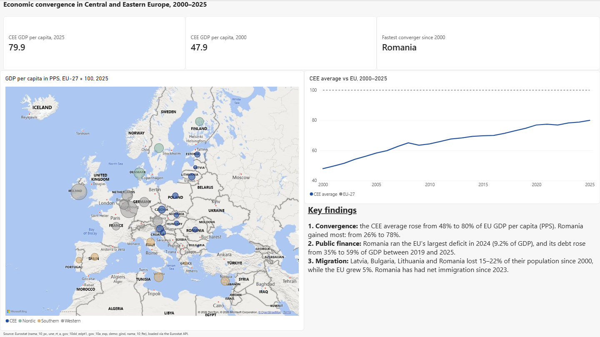
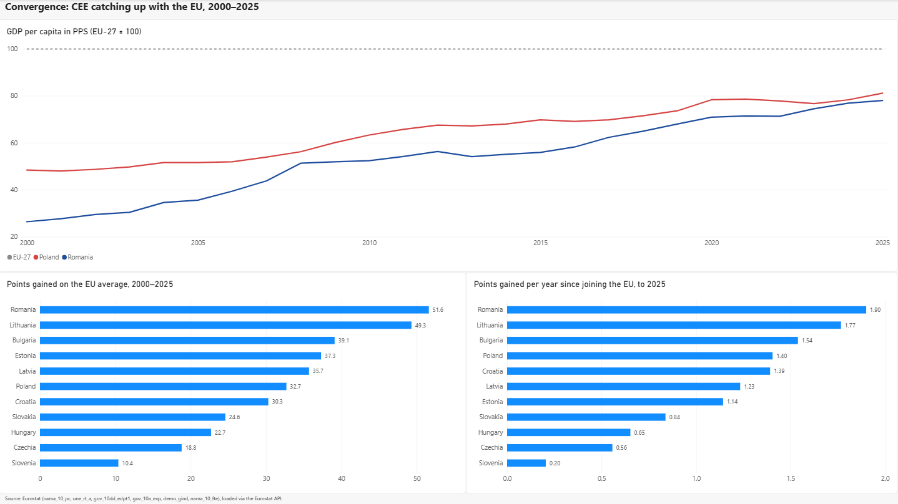
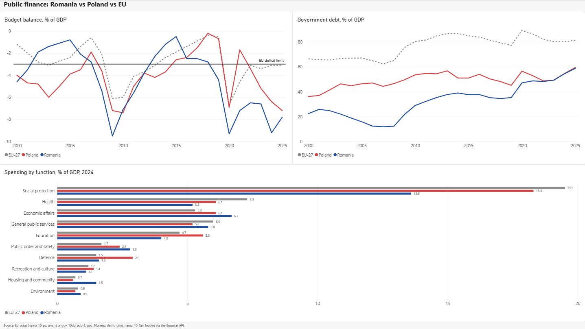
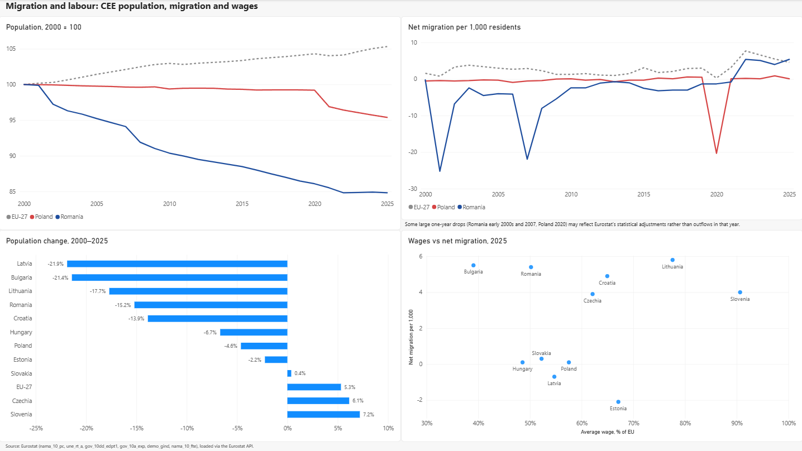
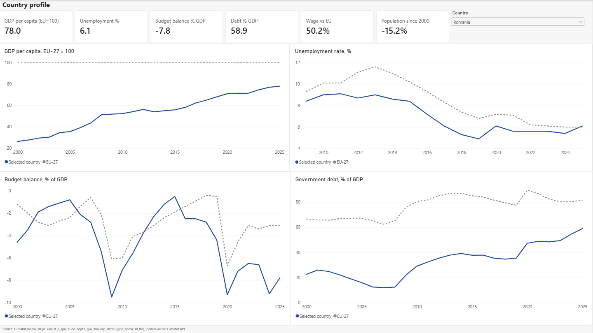

# Economic convergence in Central and Eastern Europe, 2000–2025

A Power BI report on how far the 11 Central and Eastern European (CEE) EU members have caught up with the EU average since 2000. It covers growth, public finances, migration and labour. All data is imported from the Eurostat API when the report is refreshed. The written findings are fixed text, based on the data as of November 2026.

## Questions

1. How fast has each CEE country closed the gap to the EU average in GDP per capita?
2. How do Romania's and Poland's deficits, debt and spending priorities compare with the EU?
3. How did populations change, and how did wage levels relate to net migration across CEE countries in 2025?

## Key findings

1. **Convergence:** the CEE average rose from 48% to 80% of EU GDP per capita (in purchasing power standards) between 2000 and 2025. Romania recorded the largest gain among the 11 countries, rising from 26.4% of the EU average in 2000 to 78.0% in 2025. From EU accession in 2007 to 2025, it gained an average of 1.9 percentage points per year.
2. **Public finance:** Romania ran the EU's largest deficit in 2024 (9.2% of GDP), above the EU's 3% limit every year since 2019. Its debt rose from 35% of GDP in 2019 to 59% in 2025. It spends less than the EU average on health (5.2% vs 7.3% of GDP) and on social protection (13.6% vs 19.5%).
3. **Migration:** Latvia, Bulgaria, Lithuania and Romania lost 15–22% of their population between 2000 and 2025, while the EU grew by 5%. Since 2023, Romania has had net immigration (around 4–5 per 1,000 residents a year), although its wages are still about half the EU average.

## Report pages

| Page | What it shows |
|---|---|
| Overview | Headline numbers, a map of GDP per capita, the CEE average against the EU, and the key findings |
| Convergence | GDP per capita over time, and a ranking of CEE countries by catch-up since 2000 and since joining the EU |
| Public finance | Budget balance and debt for Romania, Poland and the EU, and spending by government function |
| Migration and labour | Population change, net migration, and wages against migration |
| Country profile | Any EU country, picked with a slicer: six headline indicators, and four trends (GDP per capita, unemployment, budget balance and debt) compared with the EU |

| | |
|---|---|
|  |  |
|  |  |

## Data

Every table is loaded straight from the Eurostat SDMX API with Power Query, not from downloaded files. Each query asks only for the series it needs, for example:

`https://ec.europa.eu/eurostat/api/dissemination/sdmx/2.1/data/nama_10_pc/A.PC_EU27_2020_HAB_MPPS_CP.B1GQ.?format=SDMX-CSV&startPeriod=2000`

| Table | Eurostat dataset | Indicator |
|---|---|---|
| FactGDP | `nama_10_pc` | GDP per capita in PPS, EU-27 = 100 |
| FactUnemployment | `une_rt_a` | Unemployment rate, age 15–74, % of labour force |
| FactFinance | `gov_10dd_edpt1` | Government budget balance and gross debt, % of GDP |
| FactSpending | `gov_10a_exp` | General government spending by function (COFOG), % of GDP |
| FactPopulation | `demo_gind` | Population on 1 January and crude rate of net migration |
| FactWages | `nama_10_fte` | Average full-time adjusted salary per employee, EUR |

Coverage: the 27 EU countries and the EU-27 total, 2000–2025. CEE means Bulgaria, Croatia, Czechia, Estonia, Hungary, Latvia, Lithuania, Poland, Romania, Slovakia and Slovenia.

## How it is built

- **Power Query:** one reusable function, `GetEurostat(code, key)`, downloads a dataset, keeps the EU countries and sets the column types. Each fact table is a single call to it.
- **Star schema:** six fact tables share three dimension tables. These are `DimCountry` (with region and EU accession year), `DimYear` and `DimFunction` (COFOG spending categories). All relationships are one-to-many and filter in a single direction.
- **DAX measures:** change since 2000, catch-up per year since EU accession, gap to the EU average, the latest available value (`LASTNONBLANK`), EU comparison lines (`REMOVEFILTERS`), and the fastest-converging country (`TOPN`).

## Notes and limitations

- **CEE averages are unweighted:** each country counts equally. EU figures always use Eurostat's own EU-27 total, not an average of the countries.
- **Points, not percentages:** convergence is measured in percentage points of the EU average.
- **Unemployment** starts in 2009 for most countries, because that is where the current series begins.
- **Net migration** includes Eurostat's statistical adjustment. Some large one-year drops (Romania in the early 2000s and 2007, Poland in 2020) may reflect these adjustments rather than outflows in that year, so the population change over the whole period is the more reliable measure.
- **Spending by function** is shown for 2024, the latest year available for every country.
- **Wages** are in nominal euros, and the Netherlands has no data in this dataset.

## How to use it

1. Install [Power BI Desktop](https://www.microsoft.com/power-platform/products/power-bi/desktop) (free, Windows).
2. Open `cee-convergence.pbix`.
3. Click **Home → Refresh** to download the latest Eurostat data. No account or API key is needed.
